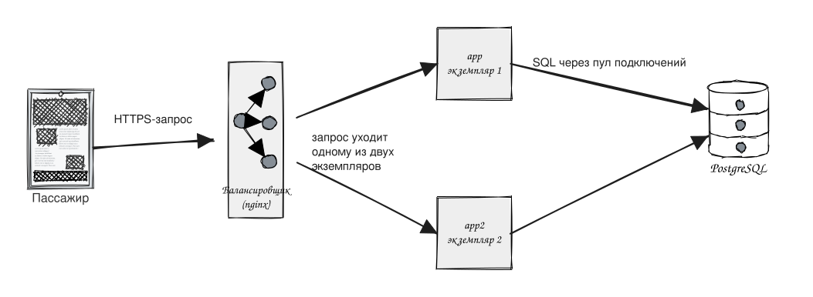
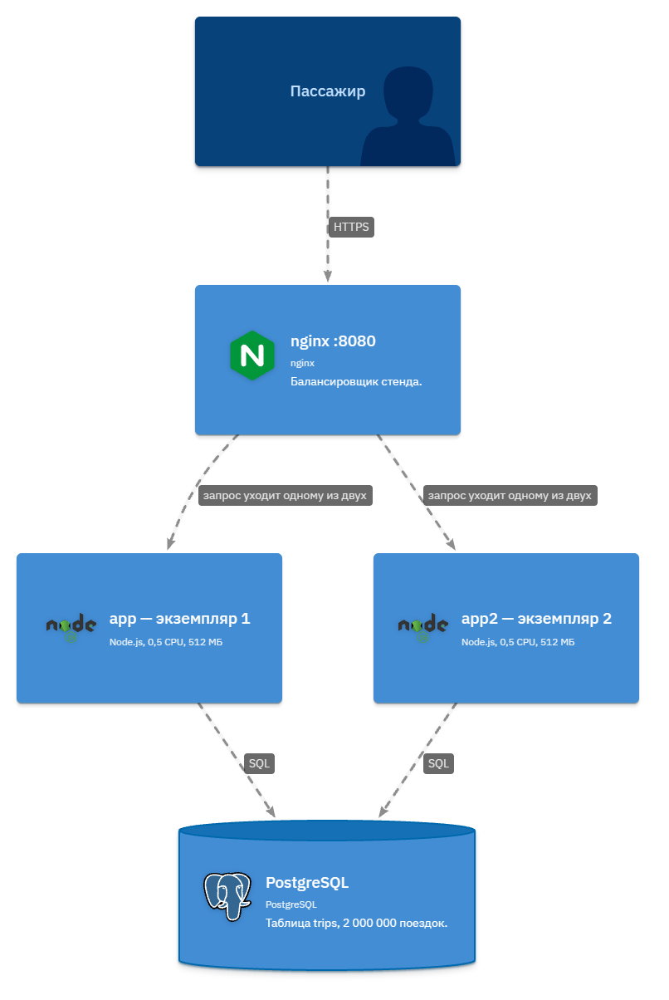
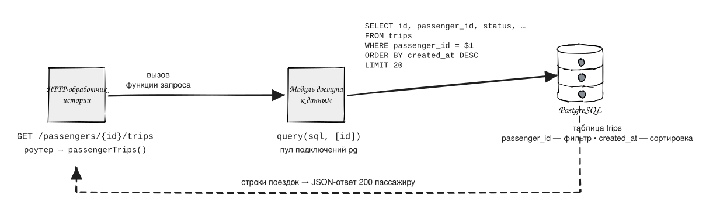
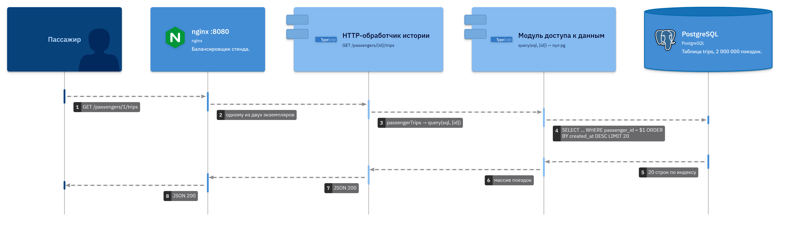

## Граница системы

Сервис такси: принимает заказ поездки, отдаёт состояние активной поездки и показывает историю поездок пассажира.

- **Назначение.** Монолит на Node.js с PostgreSQL. Три рабочих потока: создание поездки (заказ), чтение состояния активной поездки (поллинг во время поездки), просмотр истории поездок. Помимо этого сервис принимает поездку водителем, обновляет геопозицию, ищет водителей рядом и выдаёт тарифы.
- **Пользователи.** Пассажиры — создают поездки, следят за состоянием, смотрят историю. Водители — принимают поездки и обновляют геопозицию.
- **Внешние участники.** Мобильные приложения пассажиров и водителей (HTTP-клиенты сервиса), внешний сервис уведомлений (вызывается после сохранения поездки с таймаутом и повторами).
- **Граница работы.** Внутри системы — HTTP API, приложение Node.js и PostgreSQL. Снаружи — клиенты приложений и сервис уведомлений: их задержки и надёжность сервис не контролирует, только корректно обрабатывает их отказы.

## Требования

*В расчётах сутки равны 86 400 секундам.*

### Частоты потоков

**Создание поездки**, коэффициент пика ×4.

- Поездок в сутки: 200 000.
- Запросов в секунду: `200 000 ÷ 86 400 ≈ 2,31 запросов/сек`.
- Пик: `2,31 × 4 ≈ 9,26 запросов/сек`.

**Чтение состояния**, коэффициент пика ×4.

- Длительность поездки: 15 минут = 900сек.
- Запросов на 1 поездку(опрос каждые 5сек): `900 ÷ 5 = 180`.
- Запросов в сутки: `200 000 × 180 = 36 000 000`.
- Запросов в секунду: `36 000 000 ÷ 86 400 ≈ 416,7 запросов/сек`.
- Пик: `416,7 × 4 ≈ 1666,7 запросов/сек`.

**Просмотр истории**, коэффициент пика ×2.

- Открытий в сутки: 60 000.
- Запросов в сутки: `60 000 ÷ 86 400 ≈ 0,69 запросов/сек`.
- Пик: `0,69 × 2 ≈ 1,39 запросов/сек`.

Приложение `read-heavy`.

### Объём поездок за год

- Поездок в сутки: 200 000.
- Поездок за год: `200 000 × 365 = 73 000 000`.

### Цели

- История поездок: p95 ≤ 50 мс при 2 000 000 поездок в базе.
- Допустимая доля ошибок: ≤ 0,1 % запросов — не больше одного отказа на тысячу.

### Локальный стенд

Стенд работает на одной ограниченной машине и не воспроизводит пики продакшена в сотни и тысячи запросов/с. Назначение стенда — проверить причинную связь на ограниченной машине: что задержка истории зависит от решения, например наличия индекса при 2 000 000 поездок, а не от мощности железа. Если на стенде p95 укладывается в цель, решение признают работающим; вывод о поведении в полном масштабе по локальному прогону не делают.

## Операции

| Операция         | Сценарий                                                                                       | Пиковая частота       |
|------------------|------------------------------------------------------------------------------------------------|-----------------------|
| Создание поездки | Пассажир заказывает поездку в приложении                                                       | ≈ 9,26 запросов/сек   |
| Чтение состояния | Приложение опрашивает статус каждые 5 с во время 15-минутной поездки — 180 запросов на поездку | ≈ 1666,7 запросов/сек |
| Просмотр истории | Пассажир открывает список прошлых поездок                                                      | ≈ 1,39 запросов/сек   |

## Окружение

1. Запрос пассажира приходит по HTTPS на nginx.
2. Балансировщик выбирает один из двух экземпляров приложения (`app` и `app2`). Пик нагрузки делится между ними, а отказ одного не останавливает сервис.
3. Оба экземпляра ходят в один PostgreSQL через пул подключений.

_P.s. Формат LikeC4 ближе для работы с проектами/архитектурой_

## Компоненты

Критический путь истории от HTTP-запроса до ответа:

1. Приложение пассажира отправляет `GET /passengers/{id}/trips` на nginx.
2. nginx передаёт запрос одному из двух экземпляров приложения.
3. Роутер сопоставляет путь с обработчиком `passengerTrips` (src/index.ts → src/handlers.ts).
4. Обработчик вызывает модуль доступа к данным `query(sql, [id])` через пул подключений pg; при `READ_HISTORY_FROM_REPLICA=true` чтение уходит на реплику, иначе на первичную базу.
5. PostgreSQL выполняет запрос к таблице `trips`: фильтр по `passenger_id`, сортировка `created_at DESC`, `LIMIT 20`.
6. Строки преобразуются в JSON, экземпляр отвечает 200, nginx возвращает ответ приложению пассажира.

_P.s. Формат LikeC4 ближе для работы с проектами/архитектурой_

## Модель данных

Связь таблиц: один пассажир — много поездок. В `trips` внешний ключ `passenger_id` ссылается на `passengers.id`.

- `passengers`: id, name, phone.
- `trips`: id, passenger_id → passengers.id, driver_id, status, price, pickup_address, destination_address, cancel_reason, created_at.

Поля запроса истории:

- **Фильтр — `passenger_id`.** История личная: пассажир видит только собственные поездки, поэтому запрос режет таблицу по внешнему ключу пассажира.
- **Сортировка — `created_at DESC`.** Список читают сверху вниз, и первыми должны быть свежие поездки, поэтому порядок — по времени создания по убыванию. `LIMIT 20` покрывает первый экран.

## Итог

| Требование                                | Базовый результат                                                    | Решение                                                            | Повторный результат                                  |
|-------------------------------------------|----------------------------------------------------------------------|--------------------------------------------------------------------|------------------------------------------------------|
| p95 ≤ 50 мс при 2 000 000 поездок | 106,36 мс — цель нарушена; план: Parallel Seq Scan, ≈2 000 000 строк | Составной индекс `trips (passenger_id, created_at DESC)`, миграция | 3,08 мс — цель выполнена; план: Index Scan, 20 строк |

### Граница вывода

Индекс поездки пассажира устранил узкое место истории при условиях:

- 2 000 000 поездок у 10 000 пассажиров (по 200 у каждого) из `make seed-large`;
- профиль mixed: 5 созданий поездки/с + 20 чтений состояния/с + 5 чтений истории/с, разогрев 10 с, длительность 30 с;
- стенд: 2 экземпляра приложения с лимитами 0,5 CPU и 512 МБ, nginx, PostgreSQL; оба прогона без ошибок (0 %) и без пропущенных итераций (dropped_iterations = 0), значит заявленная частота подана и сравнение валидно.

Опыт подтверждает связь «состав индекса → план запроса → задержка» на этом объёме и профиле. Он не предсказывает предел городской системы целиком: с пиком ≈ 1666,7 чтения состояния в секунду и 73 000 000 поездок за год у системы другие частоты, другой объём и, возможно, другие узкие места.

### Следующий ожидаемый предел

История после индекса отвечает за 2,3 мс и перестала быть проблемой сервиса. По количеству запросов впереди всех чтение состояния «сколько осталось ехать». В стенде это 20 из 24 запросов в секунду (83 %), а в городе в час пик — 1667 из 1678, то есть почти все (99 %). Каждый такой опрос — отдельное обращение приложения к базе, а каждому экземпляру приложения досталось только пол-ядра процессора. Поэтому следующим узким местом ждём приложение - успеет ли оно отвечать на сотни вопросов о состоянии в секунду.

### Следующий опыт

Выдержит ли стенд возросшую частоту чтения состояния без роста задержек?

- Что меняем: одну цифру в `load/profile.json` — частоту чтения состояния с 20 до 200 запросов/сек. Объём данных, длительность прогона и остальные частоты не трогаем.
- Когда опыт засчитан: 95 % ответов о состоянии приходят быстрее 50 мс — та же планка, что и у истории; ошибок не больше 0,1 %; генератор не пропустил ни одного запроса (dropped_iterations = 0).
